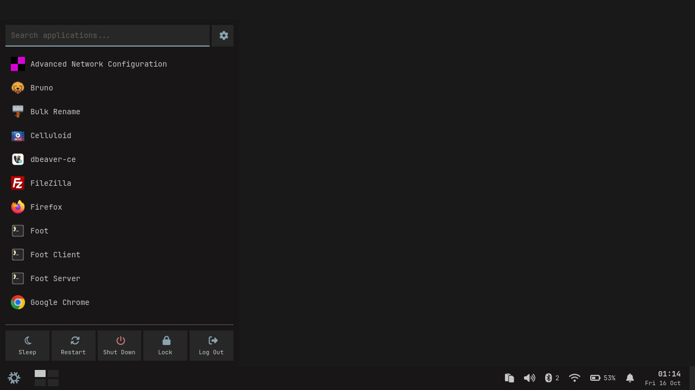
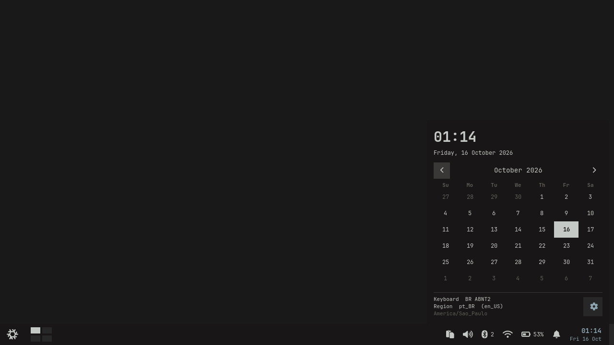
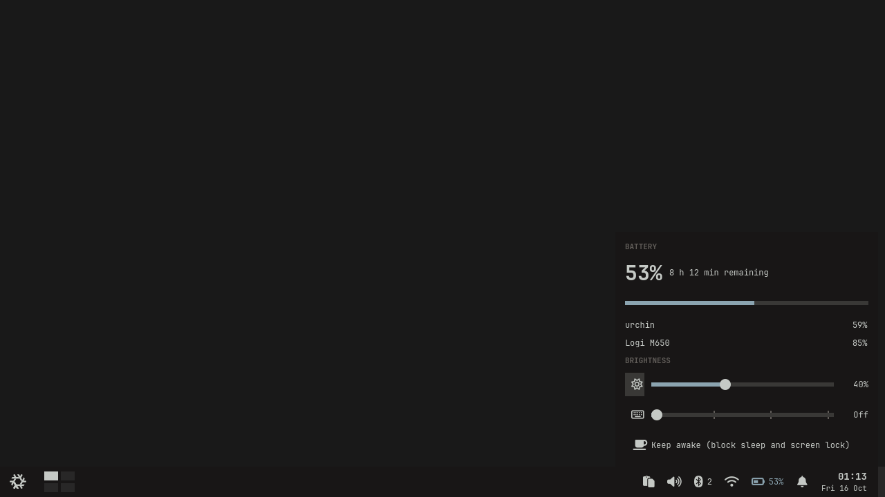
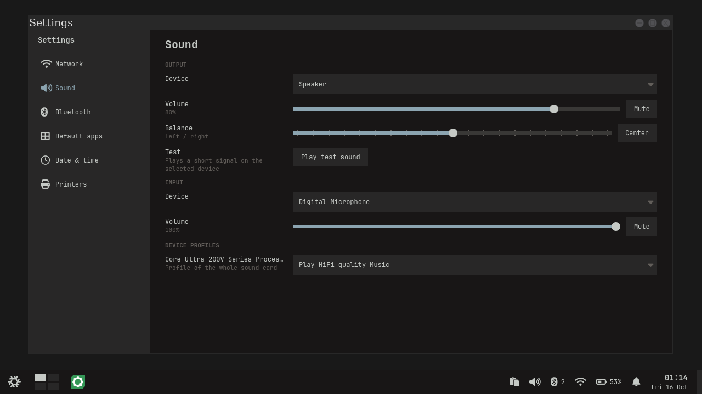

# normal-shell

A small, keyboard-friendly floating desktop for NixOS, built from two parts:

- **Wayfire** as the compositor (`compositor/`): floating windows, thin borders, workspaces on a 2x2 grid, a few Lua scripts for the keys.
- **Quickshell** as the shell (`quickshell/`): panel, start menu, tray popups, Settings app, lock screen, notifications and a screen-share picker. All QML, no daemons of its own.

It is meant to feel like a lightweight KDE without Plasma: a taskbar with a start menu, a workspace pager, tray popups for Wi-Fi, sound, Bluetooth, battery, clipboard history and calendar, and a Settings window.

| Start menu | Calendar |
|---|---|
|  |  |
| **Battery and brightness** | **Settings: Sound** |
|  |  |

## Install (NixOS + home-manager)

You need NixOS with flakes and home-manager already set up.

**1. Clone it to your home directory.** The config files are symlinked from here, so edits go live without a rebuild.

```sh
git clone https://github.com/MatheusSchneiderr/normal-shell ~/normal-shell
```

**2. System side.** Add `nix/nixos.nix` to your NixOS imports. It enables Wayfire (with the extra plugins), greetd with tuigreet as the login screen, PipeWire, Bluetooth, NetworkManager, UPower, polkit and printing.

```nix
imports = [ ./path/to/normal-shell/nix/nixos.nix ];
```

**3. User side.** Add `nix/home.nix` to your home-manager imports. It links the configs, installs the packages and sets up the user services (clipboard history, idle lock, wallpaper, screen-share picker).

```nix
imports = [ ./path/to/normal-shell/nix/home.nix ];
```

**4. Wallpaper.** Put an image at `~/Pictures/wallpaper.jpg`, or change the path in `nix/home.nix`.

**5. Rebuild and log in.**

```sh
sudo nixos-rebuild switch --flake .#your-host
```

Log in through tuigreet and pick it as the session (it starts `wayfire`).

### Make it yours

Edit these before the first login. The defaults are for a Brazilian keyboard on a 2880x1800 laptop screen.

| What | Where |
|---|---|
| Keyboard layout, screen mode and scale, cursor theme | `compositor/wayfire.ini` (`[input]`, `[output:eDP-1]`) |
| Colours and font | `quickshell/theme.json` |
| Terminal and file manager | `[command]` in `compositor/wayfire.ini` (`foot`, `thunar`) |
| Wallpaper | `nix/home.nix` |

After changing `theme.json`, reload the panel without restarting it:

```sh
quickshell -c panel ipc call theme reload
```

### Not on NixOS

The pieces are plain files, so you can wire them up by hand: link `quickshell/` to `~/.config/quickshell/panel`, copy `theme.json` to `~/.config/quickshell/theme.json`, put `compositor/wayfire.ini` at `~/.config/wayfire.ini` (replace `@home@` with your home directory) and the Lua files in `~/.config/wayfire/`. You need Wayfire 0.10 with the extra plugins, Quickshell 0.3, Lua 5.4 with luasocket and cjson, and the tools listed in `nix/home.nix`. This path is untested.

## Keys

`Super` is the logo key.

| Keys | Action |
|---|---|
| `Super` | Start menu |
| `Super+Enter` / `Super+E` | Terminal / file manager |
| `Super+H J K L` | Focus the next window in that direction; at the edge, switch workspace |
| `Super+Alt+H J K L` | Send the focused window to the neighbouring workspace |
| `Super+Shift+H J K L` | Move the window (hold to repeat) |
| `Super+R` | Resize mode, then use the arrow keys |
| `Super+S` | Pin the window on every workspace |
| `Super+F` / `Super+M` | Fullscreen / maximize |
| `Super+D` | Show the desktop, press again to restore |
| `Super+V` | Clipboard history |
| `Super+N` | Notifications |
| `Super+I` | Settings |
| `Super+Alt+Esc` | Lock |
| `Alt+Tab` | Switch windows |
| `Super+W` | Overview of windows |
| `Ctrl+1..4`, `Alt+1..4` | Go to workspace, send window to workspace |
| `Print`, `Super+Print` | Screenshot a region / the screen |

The full list is in `compositor/wayfire.ini`.

## How it is laid out

```
compositor/   wayfire.ini and the Lua helpers that talk to Wayfire's IPC socket
quickshell/
  shell.qml     entry point
  components/   generic UI pieces
  services/     logic without UI (commands, polling, preferences)
  shell/        panel, start menu, popup host, Settings window
  modules/      one folder per feature (network, sound, bluetooth, battery, ...)
  rules.md      the rules for adding code
  dev/          a headless test setup
nix/          home-manager and NixOS wiring
```

A feature is a folder in `modules/` with a tray button, a popup and a Settings page that share their parts. `quickshell/rules.md` explains the conventions and `quickshell/new-module.sh <name>` scaffolds a new one.

## Developing

`quickshell/dev/smoke.sh` boots the whole shell in a headless Wayfire, opens every popup and Settings page, and fails on any QML warning. It never touches your real session. `quickshell/check.sh` checks the style rules. See `quickshell/dev/README.md`.

## Known limits

- Screen sharing offers whole screens only. Wayfire does not expose window capture to the portal.
- Settings cannot change the time zone, language or keyboard layout; those stay declarative in NixOS and are shown read-only.
- Tested on a single laptop (Intel graphics, NixOS unstable). Expect rough edges elsewhere.

## License

MIT
